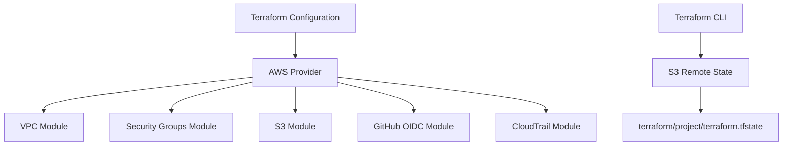
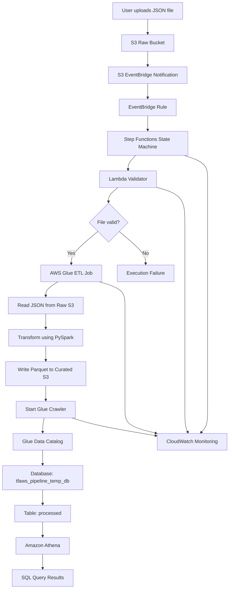

# Terraform AWS Infrastructure and Automated Data Pipeline

## 1. Project Overview

This project provisions AWS infrastructure using Terraform and demonstrates an event-driven data processing pipeline using AWS managed services.

It has two independently managed layers:

1. **Core AWS foundation:** VPC, security groups, S3, GitHub OIDC and CloudTrail.
2. **Temporary data pipeline:** A separately managed ingestion and processing workflow for development and validation.

The deployment region is Mumbai (`ap-south-1`).

### Objectives

- Provision AWS infrastructure as Code.
- Maintain Terraform state remotely in Amazon S3.
- Isolate temporary pipeline resources from the existing foundation.
- Ingest JSON files from S3.
- Validate incoming files with Lambda.
- Orchestrate processing with Step Functions.
- Transform JSON into Parquet with AWS Glue.
- Store curated data in S3.
- Discover schemas with Glue Crawler and Data Catalog.
- Query processed data with Athena.
- Monitor execution with CloudWatch.
- Apply IAM, encryption and cost controls.

### Environment

| Setting | Value |
|---|---|
| AWS account | `155335454656` |
| AWS region | `ap-south-1` |
| Terraform | `1.10.5` |
| AWS provider | `6.73.0` |
| Backend | Amazon S3 |
| State locking | S3 native lockfile |
| State encryption | Enabled |
| Pipeline environment | Temporary / Dev |
| Redshift | Excluded |

### AWS services

| Service | Purpose |
|---|---|
| Amazon VPC | Core network foundation |
| Amazon S3 | Terraform state, raw data, curated data and Athena results |
| AWS IAM | Service roles and permissions |
| GitHub OIDC | GitHub Actions authentication foundation |
| AWS CloudTrail | Account activity auditing |
| Amazon EventBridge | Detect S3 object-created events |
| AWS Lambda | Validate incoming JSON files |
| AWS Step Functions | Orchestrate the workflow |
| AWS Glue ETL | Transform JSON into Parquet |
| AWS Glue Crawler | Discover processed-data schema |
| AWS Glue Data Catalog | Store table metadata |
| Amazon Athena | SQL queries over curated data |
| Amazon CloudWatch | Logs, metrics and alarms |

Redshift, EMR and Databricks are not part of this implementation.

---

## 2. Architecture

### 2.1 Core infrastructure

The existing Terraform foundation is maintained independently of the temporary pipeline.



Core network details:

| Resource | Configuration |
|---|---|
| VPC CIDR | `10.10.0.0/16` |
| Public subnet | `10.10.1.0/24` |
| Private subnet | `10.10.2.0/24` |
| Availability Zone | `ap-south-1a` |
| NAT Gateway | Disabled |

### 2.2 Temporary data pipeline



### 2.3 Storage zones

| Zone | Bucket | Purpose |
|---|---|---|
| Raw | `tfaws-pipeline-temp-raw-155335454656-ap-south-1` | Incoming JSON files and Glue script |
| Curated | `tfaws-pipeline-temp-curated-155335454656-ap-south-1` | Processed Parquet data |
| Query results | `tfaws-pipeline-temp-results-155335454656-ap-south-1` | Athena query output |

---

## 3. Repository Structure

The known project structure is:

```text
terraform-aws-infrastructure/
├── modules/
│   ├── vpc/
│   ├── security_groups/
│   ├── s3/
│   ├── github_oidc/
│   └── cloudtrail/
├── environments/
│   └── dev-pipeline-temp/
│       ├── versions.tf
│       ├── main.tf
│       ├── lambda/
│       │   ├── validator.py
│       │   └── validator.zip
│       └── glue/
│           └── etl.py
├── main.tf
├── versions.tf
├── provider.tf
├── outputs.tf
├── .terraform.lock.hcl
└── evidence/
    └── data-pipeline-temp-20261118/
```

The root configuration manages the existing foundation. The separate `environments/dev-pipeline-temp/` configuration manages the temporary pipeline.

The pipeline uses a separate Terraform state key so that its lifecycle can be managed independently.

---

## 4. Terraform Implementation

### 4.1 Terraform and provider requirements

The root configuration requires:

```hcl
terraform {
  required_version = ">= 1.10.0"

  required_providers {
    aws = {
      source  = "hashicorp/aws"
      version = "~> 6.0"
    }
  }
}
```

The deployment used Terraform `1.10.5` and AWS provider `6.73.0`.

### 4.2 Provider region and tags

The provider region is `ap-south-1`.

The temporary pipeline uses these default tags:

| Tag | Value |
|---|---|
| Project | `Terraform-AWS-Data-Pipeline` |
| Environment | `Temporary` |
| ManagedBy | `Terraform` |
| Owner | `Infrastructure-Team` |

### 4.3 Remote state

State bucket:

```text
terraform-state-155335454656-ap-south-1-20261116
```

Core state key:

```text
terraform/project/terraform.tfstate
```

Temporary pipeline state key:

```text
terraform/project/data-pipeline-temp.tfstate
```

Temporary backend configuration:

```hcl
terraform {
  backend "s3" {
    bucket       = "terraform-state-155335454656-ap-south-1-20261116"
    key          = "terraform/project/data-pipeline-temp.tfstate"
    region       = "ap-south-1"
    encrypt      = true
    use_lockfile = true
  }
}
```

The distinct state key is a safety boundary. It allows pipeline cleanup without targeting the core infrastructure state.

### 4.4 Core modules

The existing root project includes:

- VPC
- Security groups
- S3
- GitHub OIDC
- CloudTrail

The existing foundation was preserved during pipeline deployment.

### 4.5 Temporary pipeline Terraform resources

The temporary configuration deployed 38 resources. Its resource groups include:

| Resource | Terraform address |
|---|---|
| S3 buckets | `aws_s3_bucket.pipeline` |
| S3 encryption | `aws_s3_bucket_server_side_encryption_configuration.pipeline` |
| S3 public access blocks | `aws_s3_bucket_public_access_block.pipeline` |
| S3 bucket policies | `aws_s3_bucket_policy.pipeline` |
| S3 lifecycle | `aws_s3_bucket_lifecycle_configuration.pipeline` |
| S3 ownership | `aws_s3_bucket_ownership_controls.pipeline` |
| S3 EventBridge notification | `aws_s3_bucket_notification.raw` |
| Lambda | `aws_lambda_function.validator` |
| Lambda log group | `aws_cloudwatch_log_group.validator` |
| Glue database | `aws_glue_catalog_database.pipeline` |
| Glue job | `aws_glue_job.pipeline` |
| Glue crawler | `aws_glue_crawler.pipeline` |
| IAM roles | `aws_iam_role.*` |
| IAM policies | `aws_iam_role_policy.*` |
| Step Functions | `aws_sfn_state_machine.pipeline` |
| EventBridge rule | `aws_cloudwatch_event_rule.raw_object_created` |
| EventBridge target | `aws_cloudwatch_event_target.pipeline` |
| Athena workgroup | `aws_athena_workgroup.pipeline` |
| CloudWatch alarm | `aws_cloudwatch_metric_alarm.lambda_errors` |

---

## 5. Step-by-Step Implementation

### Step 1: Prepare CloudShell

Deployment was performed in AWS CloudShell using an IAM Identity Center administrator session, not the root account.

```bash
export AWS_DEFAULT_REGION=ap-south-1
export AWS_PAGER=""

cd "$HOME/terraform-aws-infrastructure"

"$HOME/bin/terraform" version
aws sts get-caller-identity
```

Terraform was installed at `$HOME/bin/terraform`.

### Step 2: Configure the provider cache

```bash
export TF_PLUGIN_CACHE_DIR="$HOME/terraform-aws-infrastructure/.terraform/providers"
```

This allowed the temporary configuration to reuse the cached AWS provider.

### Step 3: Create S3 zones

Three buckets were provisioned. Each has:

- Public access block.
- SSE-S3 default encryption.
- Ownership controls.
- Lifecycle configuration.
- A bucket policy denying insecure transport.

Configured lifecycle expiration:

| Bucket | Expiration |
|---|---:|
| Raw | 14 days |
| Curated | 30 days |
| Results | 3 days |

The temporary buckets use `force_destroy = true`. This permits Terraform cleanup of non-empty buckets, but also means their contents are permanently deleted during destruction.

### Step 4: Configure Lambda

Function:

```text
tfaws-pipeline-temp-validator
```

| Setting | Value |
|---|---|
| Runtime | Python 3.12 |
| Memory | 128 MB |
| Timeout | 30 seconds |

The validator extracts the bucket and object key from the EventBridge event, URL-decodes the key, and requires the `raw/` prefix and `.json` suffix.

### Step 5: Configure EventBridge

Rule:

```text
tfaws-pipeline-temp-raw-object-created
```

The raw bucket has EventBridge notifications enabled. The rule filters object-created events for the raw prefix and targets:

```text
tfaws-pipeline-temp-orchestrator
```

EventBridge assumes its dedicated role and calls `states:StartExecution`.

### Step 6: Configure Step Functions

State machine:

```text
tfaws-pipeline-temp-orchestrator
```

The workflow:

1. Invokes Lambda validation.
2. Starts Glue ETL and waits for completion.
3. Starts the Glue Crawler.
4. Waits 15 seconds.
5. Polls crawler status.
6. Checks whether the last crawl succeeded.
7. Completes with `PipelineSucceeded` or fails.

The state machine timeout is 1,800 seconds. Glue uses the synchronous `startJobRun.sync` integration.

### Step 7: Configure Glue ETL

Job:

```text
tfaws-pipeline-temp-etl
```

| Setting | Value |
|---|---|
| Glue version | 5.0 |
| Worker type | G.1X |
| Workers | 2 |
| Timeout | 10 minutes |
| Retries | 0 |
| Maximum concurrent runs | 1 |
| Python version | 3 |

Script location:

```text
s3://tfaws-pipeline-temp-raw-155335454656-ap-south-1/scripts/etl.py
```

The script reads source bucket/key and target bucket job arguments, reads JSON with Spark, checks for records, and writes Parquet to:

```text
s3://tfaws-pipeline-temp-curated-155335454656-ap-south-1/processed/<file-name>/
```

### Step 8: Configure Glue Catalog and Crawler

Database:

```text
tfaws_pipeline_temp_db
```

Crawler:

```text
tfaws-pipeline-temp-crawler
```

Crawler target:

```text
s3://tfaws-pipeline-temp-curated-155335454656-ap-south-1/processed/
```

The crawler discovers the Parquet schema and registers the `processed` table.

### Step 9: Configure Athena

Workgroup:

```text
tfaws-pipeline-temp-workgroup
```

| Setting | Value |
|---|---|
| Engine | Version 3 |
| Results | Dedicated results bucket |
| Encryption | SSE-S3 |
| Enforce workgroup configuration | Enabled |
| CloudWatch metrics | Enabled |
| Per-query scan cutoff | 1,000,000,000 bytes |

The existing `primary` workgroup was preserved.

### Step 10: Configure monitoring

CloudWatch alarm:

```text
tfaws-pipeline-temp-lambda-errors
```

Lambda log group:

```text
/aws/lambda/tfaws-pipeline-temp-validator
```

Glue log groups observed:

```text
/aws-glue/crawlers
/aws-glue/jobs/error
/aws-glue/jobs/logs-v2
/aws-glue/jobs/output
```

---

## 6. Terraform Deployment Commands

All commands below are for the temporary pipeline unless explicitly stated otherwise.

### Initialize

```bash
export AWS_DEFAULT_REGION=ap-south-1
export AWS_PAGER=""
export TF_PLUGIN_CACHE_DIR="$HOME/terraform-aws-infrastructure/.terraform/providers"

cd "$HOME/terraform-aws-infrastructure"

"$HOME/bin/terraform" -chdir=environments/dev-pipeline-temp init
```

### Format

```bash
"$HOME/bin/terraform" -chdir=environments/dev-pipeline-temp fmt
```

Format check:

```bash
"$HOME/bin/terraform" -chdir=environments/dev-pipeline-temp fmt -check
```

### Validate

Executed successfully:

```bash
"$HOME/bin/terraform" -chdir=environments/dev-pipeline-temp validate
```

Expected:

```text
Success! The configuration is valid.
```

### Generate and inspect a saved plan

```bash
"$HOME/bin/terraform" \
  -chdir=environments/dev-pipeline-temp \
  plan -out=tfplan

"$HOME/bin/terraform" \
  -chdir=environments/dev-pipeline-temp \
  show tfplan
```

### Apply the reviewed plan

The original deployment was approved and applied:

```bash
"$HOME/bin/terraform" \
  -chdir=environments/dev-pipeline-temp \
  apply tfplan
```

Actual output:

```text
Apply complete! Resources: 38 added, 0 changed, 0 destroyed.
```

### Inspect outputs and state

```bash
"$HOME/bin/terraform" -chdir=environments/dev-pipeline-temp output

"$HOME/bin/terraform" \
  -chdir=environments/dev-pipeline-temp \
  state list
```

Actual outputs included:

```text
athena_results_bucket = "tfaws-pipeline-temp-results-155335454656-ap-south-1"
athena_workgroup = "tfaws-pipeline-temp-workgroup"
curated_bucket = "tfaws-pipeline-temp-curated-155335454656-ap-south-1"
glue_crawler = "tfaws-pipeline-temp-crawler"
glue_database = "tfaws_pipeline_temp_db"
glue_job = "tfaws-pipeline-temp-etl"
raw_bucket = "tfaws-pipeline-temp-raw-155335454656-ap-south-1"
```

### Verify drift

Executed successfully:

```bash
"$HOME/bin/terraform" \
  -chdir=environments/dev-pipeline-temp \
  plan
```

Actual result:

```text
No changes. Your infrastructure matches the configuration.
```

---

## 7. End-to-End Execution

### 7.1 Test input

The test object was `raw/pipeline-test.json`:

```json
{"record_id":1,"customer":"Sample Customer A","amount":125.50,"status":"COMPLETED"}
{"record_id":2,"customer":"Sample Customer B","amount":250.75,"status":"PENDING"}
{"record_id":3,"customer":"Sample Customer C","amount":90.00,"status":"COMPLETED"}
```

It was uploaded to:

```text
s3://tfaws-pipeline-temp-raw-155335454656-ap-south-1/raw/pipeline-test.json
```

### 7.2 Execution sequence

1. S3 generated an object-created event.
2. EventBridge detected the event.
3. EventBridge started Step Functions.
4. Lambda validated the input.
5. Step Functions started Glue.
6. Glue read the JSON input.
7. Spark converted the data to Parquet.
8. Glue wrote the curated output.
9. Step Functions started the crawler.
10. The crawler discovered the schema.
11. The Data Catalog registered the table.
12. Step Functions completed successfully.

### 7.3 Actual execution evidence

Step Functions execution ARN:

```text
arn:aws:states:ap-south-1:155335454656:execution:tfaws-pipeline-temp-orchestrator:c6d2b9f3-3105-b9e3-adef-90ca725be00f_3a9f87fa-5848-ca67-6960-b2f6b2eae16e
```

Status: `SUCCEEDED`.

Duration: approximately 2 minutes 45 seconds.

Glue job run ID:

```text
jr_6d3972693efa395db7c1da2f53b35e4004223a3929cc6cb609747453e4b62145
```

Glue status: `SUCCEEDED`.

Glue execution time: 72 seconds.

### 7.4 Curated output

The Parquet file was written under:

```text
processed/pipeline-test/
```

An observed object was:

```text
part-00000-2238f5e0-24a9-4b7a-83ce-6606d80da60e-c000.snappy.parquet
```

### 7.5 Athena results

Athena returned all three records:

| amount | customer | record_id | status | partition_0 |
|---:|---|---:|---|---|
| 125.50 | Sample Customer A | 1 | COMPLETED | pipeline-test |
| 250.75 | Sample Customer B | 2 | PENDING | pipeline-test |
| 90.00 | Sample Customer C | 3 | COMPLETED | pipeline-test |

---

## 8. Manual Testing

A valid JSON file uploaded under the `raw/` prefix should trigger the pipeline automatically.

### Create a test file

```bash
cat > manual-test.json <<'EOF'
{"record_id":101,"customer":"Test Customer A","amount":500.00,"status":"COMPLETED"}
{"record_id":102,"customer":"Test Customer B","amount":750.50,"status":"PENDING"}
{"record_id":103,"customer":"Test Customer C","amount":300.25,"status":"COMPLETED"}
EOF
```

### Upload it

```bash
aws s3 cp manual-test.json \
  s3://tfaws-pipeline-temp-raw-155335454656-ap-south-1/raw/manual-test.json
```

Expected: an upload confirmation. The S3 event should initiate the workflow.

### Check Step Functions

```bash
aws stepfunctions list-executions \
  --state-machine-arn \
  arn:aws:states:ap-south-1:155335454656:stateMachine:tfaws-pipeline-temp-orchestrator \
  --max-results 5
```

Then inspect the returned execution ARN:

```bash
aws stepfunctions describe-execution \
  --execution-arn <EXECUTION_ARN>
```

Expected status: `SUCCEEDED`.

### Check Glue

```bash
aws glue get-job-runs \
  --job-name tfaws-pipeline-temp-etl \
  --max-results 5

aws glue get-crawler \
  --name tfaws-pipeline-temp-crawler
```

Expected job state: `SUCCEEDED`. Expected crawler state after completion: `READY`, with last crawl status `SUCCEEDED`.

### Query Athena

```sql
SELECT *
FROM processed
ORDER BY record_id;
```

For the manual test:

```sql
SELECT *
FROM processed
WHERE record_id >= 101
ORDER BY record_id;
```

Expected: three records from the manual test.

The discovered table includes a `partition_0` column. Validate crawler behavior and query results after each new upload before relying on this table for production workloads.

---

## 9. AWS Console Verification

Use the AWS Console in **Asia Pacific (Mumbai), `ap-south-1`**.

### 9.1 S3

Navigate to:

`S3 → General purpose buckets`

Inspect:

| Bucket | What to verify |
|---|---|
| Raw | `raw/pipeline-test.json`, `scripts/etl.py` |
| Curated | `processed/pipeline-test/` and Parquet file |
| Results | Athena query output |

For each bucket:

- Permissions → Block public access.
- Properties → Default encryption.
- Permissions → Bucket policy.
- Management → Lifecycle rules.

Expected: all four public-access-block settings enabled, AES256 encryption, and a policy denying insecure transport.

### 9.2 EventBridge

Navigate to:

`Amazon EventBridge → Rules → tfaws-pipeline-temp-raw-object-created`

Verify the rule is enabled, the object-created event pattern includes the raw prefix, and the target is the Step Functions state machine.

### 9.3 Lambda

Navigate to:

`AWS Lambda → Functions → tfaws-pipeline-temp-validator`

Verify Active status, Python 3.12, 128 MB memory and 30-second timeout. Open Monitor and inspect CloudWatch logs.

### 9.4 Step Functions

Navigate to:

`AWS Step Functions → State machines → tfaws-pipeline-temp-orchestrator → Executions`

Open the successful execution and inspect its graph and task history.

Expected final status: `SUCCEEDED`.

### 9.5 Glue job

Navigate to:

`AWS Glue → ETL jobs → tfaws-pipeline-temp-etl → Runs`

Verify the job run is `SUCCEEDED`; inspect execution time and error message.

### 9.6 Glue Crawler

Navigate to:

`AWS Glue → Data Catalog → Crawlers → tfaws-pipeline-temp-crawler`

Verify state `READY` and last crawl status `SUCCEEDED`.

### 9.7 Glue Data Catalog

Navigate to:

`AWS Glue → Data Catalog → Databases → tfaws_pipeline_temp_db → Tables → processed`

Inspect the schema and S3 table location.

### 9.8 Athena

Navigate to:

`Amazon Athena → Query editor`

Select:

- Data source: `AwsDataCatalog`
- Database: `tfaws_pipeline_temp_db`
- Workgroup: `tfaws-pipeline-temp-workgroup`

Run:

```sql
SELECT *
FROM processed;
```

Verify the sample records.

### 9.9 CloudWatch

Navigate to:

`CloudWatch → Alarms → tfaws-pipeline-temp-lambda-errors`

The observed alarm state was `OK`.

**Important:** The recorded OK state was based on no error datapoints and a non-breaching missing-data configuration. It does not demonstrate a deliberate failure-injection test.

Inspect these log groups:

```text
/aws/lambda/tfaws-pipeline-temp-validator
/aws-glue/crawlers
/aws-glue/jobs/error
/aws-glue/jobs/logs-v2
/aws-glue/jobs/output
```

### 9.10 IAM

Navigate to:

`IAM → Roles`

Inspect:

```text
tfaws-pipeline-temp-lambda-role
tfaws-pipeline-temp-glue-role
tfaws-pipeline-temp-sfn-role
tfaws-pipeline-temp-eventbridge-role
```

Review trust relationships and inline policies.

---

## 10. Security and Best Practices

### 10.1 Dedicated IAM roles

| Role | Trusted service | Responsibility |
|---|---|---|
| `tfaws-pipeline-temp-lambda-role` | Lambda | Write Lambda logs |
| `tfaws-pipeline-temp-glue-role` | Glue | Read raw data, write curated data, use Glue Catalog and write logs |
| `tfaws-pipeline-temp-sfn-role` | Step Functions | Invoke Lambda, run Glue, start and inspect crawler |
| `tfaws-pipeline-temp-eventbridge-role` | EventBridge | Start the specific state machine |

The Step Functions role has scoped `iam:PassRole` permission for the Glue role. Its policy restricts the passed role to Glue as the receiving service.

The EventBridge trust policy restricts the source account and rule ARN.

### 10.2 Glue IAM policy tightening

The initial Glue logging statement used `Resource = "*"`. It was tightened to the four required Glue log groups.

Final logging actions:

```json
[
  "logs:CreateLogStream",
  "logs:PutLogEvents"
]
```

Final resource scope:

```text
/aws-glue/crawlers
/aws-glue/jobs/error
/aws-glue/jobs/logs-v2
/aws-glue/jobs/output
```

The updated policy was applied and verified in AWS IAM and Terraform state. A subsequent Terraform plan reported no changes.

### 10.3 S3 security

All three buckets were verified with:

- `BlockPublicAcls = true`
- `IgnorePublicAcls = true`
- `BlockPublicPolicy = true`
- `RestrictPublicBuckets = true`
- Default SSE-S3 encryption using AES256.
- Bucket policies denying insecure transport.

### 10.4 Athena security

The dedicated workgroup enforces its configuration, uses SSE-S3 result encryption, publishes CloudWatch metrics and has a 1 GB scanned-data cutoff per query.

### 10.5 Terraform state security

Terraform state is stored remotely in S3 with encryption and native S3 lockfile support. The root and temporary pipeline use separate keys.

Do not commit state files, saved plans, credentials, secret variable files or provider caches.

### 10.6 Secrets management

Do not store AWS credentials or access keys in Terraform source, scripts or GitHub repositories. Use IAM Identity Center for interactive administration and OIDC for GitHub Actions authentication.

No application secrets are required by the demonstrated data-processing workflow.

### 10.7 Network design

The existing VPC has a public subnet, private subnet and Internet Gateway. NAT Gateway is disabled.

The tested pipeline uses AWS-managed service integrations and does not require a VPC attachment for the tested Lambda or Glue workloads. Avoid adding NAT infrastructure without a concrete requirement.

### 10.8 Cost considerations

Glue is the main cost-sensitive compute service in this design.

Cost controls include:

- Two G.1X workers.
- Ten-minute Glue job timeout.
- Zero retries.
- One concurrent Glue run.
- Athena scanned-data cutoff.
- S3 lifecycle expiration.
- Temporary infrastructure separation.

AWS charges can continue while resources remain deployed. Cost Explorer data can be delayed. No claim of zero cost is made.

---

## 11. Technical Decisions and Alternatives

| Decision | Why selected | Alternative not selected |
|---|---|---|
| Terraform | Declarative, repeatable infrastructure, saved plans and state management | Manual Console provisioning |
| S3 storage zones | Durable object storage with Glue and Athena integration | EFS or EBS, which are not needed for this object-based workflow |
| EventBridge | Event-driven processing without continuous polling | Scheduled polling |
| Lambda validation | Small serverless validation task | EC2-hosted validation service |
| Step Functions | Managed orchestration, execution history and service integrations | Custom Lambda chaining |
| Glue | Managed Spark ETL and native Catalog integration | EMR, which adds cluster operations |
| Parquet | Columnar analytical format | JSON or CSV as the final analytical format |
| Athena | Serverless SQL over S3 | Redshift, explicitly excluded from scope |
| Separate Terraform state | Isolates temporary lifecycle from the core foundation | Managing all resources in the root state |

### Why Parquet?

Parquet is columnar and is generally more efficient for analytical queries than raw JSON or CSV, particularly when queries read only selected columns.

### Why Athena?

Athena supports SQL queries directly over S3 without requiring a continuously running data warehouse.

### Why separate Terraform states?

The temporary pipeline can be planned and destroyed independently, reducing the risk of accidentally changing or deleting the existing foundation.

---

## 12. Testing, Validation and Troubleshooting

### 12.1 Observed validation results

| Test | Actual result |
|---|---|
| Terraform initialization | Successful |
| Terraform validation | Successful |
| Terraform deployment | 38 added, 0 changed, 0 destroyed |
| S3 event trigger | Successful |
| Lambda validation | Successful |
| Step Functions | `SUCCEEDED` |
| Glue ETL | `SUCCEEDED` |
| Glue execution time | 72 seconds |
| Glue Crawler | `SUCCEEDED` |
| Glue Catalog registration | Successful |
| Parquet output | Created |
| Athena query | Successful |
| Records returned | 3 |
| S3 public access controls | Verified |
| SSE-S3 encryption | Verified |
| Athena workgroup enforcement | Verified |
| IAM trust policies | Reviewed |
| Glue IAM tightening | Applied |
| Terraform drift check | No changes |

### 12.2 Troubleshooting guide

| Problem | Possible cause | Check |
|---|---|---|
| No Step Functions execution | Event not delivered or rule disabled | EventBridge rule and target |
| Lambda validation failure | Wrong prefix or extension | Use `raw/` and `.json` |
| Glue job fails | Invalid JSON, permissions or ETL error | Glue run details and logs |
| No Parquet output | ETL failure or wrong output path | Glue run and curated bucket |
| Crawler fails | Missing S3 or Catalog permissions | Crawler role and logs |
| Athena table missing | Crawler did not complete | Crawler status and Catalog |
| Athena returns no rows | Wrong database, partition or table location | Catalog table properties |
| Terraform shows unexpected changes | Drift or configuration changes | Review saved plan |
| Terraform cannot find provider | Cache or initialization issue | `TF_PLUGIN_CACHE_DIR` |
| CloudShell recovery mode | Shell startup or command exit behavior | Reopen CloudShell; use absolute Terraform path |

### 12.3 CloudShell environment

The deployment used:

```bash
export AWS_DEFAULT_REGION=ap-south-1
export AWS_PAGER=""
export TF_PLUGIN_CACHE_DIR="$HOME/terraform-aws-infrastructure/.terraform/providers"
```

Terraform was invoked as:

```bash
"$HOME/bin/terraform"
```

---

## 13. Evidence and Audit Records

Evidence was collected under:

```text
evidence/data-pipeline-temp-20261118/
```

The collected files included:

```text
terraform-outputs.json
terraform-state-list.txt
terraform-plan.txt
step-functions-execution.json
step-functions-history.json
glue-job-runs.json
glue-crawler.json
athena-workgroup.json
cloudwatch-alarms.json
tfaws-pipeline-temp-raw-155335454656-ap-south-1-objects.json
tfaws-pipeline-temp-curated-155335454656-ap-south-1-objects.json
tfaws-pipeline-temp-results-155335454656-ap-south-1-objects.json
```

These records preserve deployment outputs, execution details, Glue results, Athena configuration and S3 object inventories. They were collected locally in CloudShell and are not necessarily committed to Git.

---

## 14. Cleanup and Safe Destruction

### 14.1 Important warning

The pipeline was intended as temporary infrastructure: deploy, test, capture evidence, review costs and then clean up.

The pipeline was successfully deployed and tested. Cost review and cleanup were still pending in the last recorded project status.

**Never run Terraform destroy from the repository root.**

### 14.2 Verify the temporary state

```bash
"$HOME/bin/terraform" \
  -chdir=environments/dev-pipeline-temp \
  state list
```

Confirm that the state contains only temporary pipeline resources.

### 14.3 Generate a destroy plan

Only after evidence and cost reviews are complete:

```bash
"$HOME/bin/terraform" \
  -chdir=environments/dev-pipeline-temp \
  plan -destroy -out=destroy.tfplan
```

Review it:

```bash
"$HOME/bin/terraform" \
  -chdir=environments/dev-pipeline-temp \
  show destroy.tfplan
```

Confirm that it targets only temporary pipeline resources. It must not include the VPC, root S3 foundation, CloudTrail, GitHub OIDC or other existing resources.

### 14.4 Apply only after explicit approval

After reviewing the destroy plan and obtaining explicit authorization:

```bash
"$HOME/bin/terraform" \
  -chdir=environments/dev-pipeline-temp \
  apply destroy.tfplan
```

Do not apply an unreviewed or regenerated destroy plan.

### 14.5 Verify cleanup

```bash
"$HOME/bin/terraform" \
  -chdir=environments/dev-pipeline-temp \
  state list
```

The expected managed-resource inventory is empty. Also verify the temporary buckets, Glue resources, Lambda function, EventBridge rule, Step Functions state machine and Athena workgroup have been removed.

### 14.6 Preserve the core foundation

Do not remove:

- Root Terraform state.
- Existing VPC and subnets.
- Existing security groups.
- Existing application S3 bucket.
- Existing CloudTrail infrastructure.
- Existing GitHub OIDC resources.
- Existing Glue and Lambda resources belonging to other workloads.

The separate Terraform state is the main boundary protecting the existing foundation.

---

## 15. Interview Preparation

### 15.1 Two-minute project explanation

This project demonstrates an AWS data ingestion and processing pipeline provisioned using Terraform.

A user uploads a JSON file into an S3 raw bucket. EventBridge detects the object-created event and starts a Step Functions workflow.

The workflow invokes Lambda to validate the file, then runs an AWS Glue ETL job. Glue reads the JSON data and transforms it into Parquet before storing it in a curated S3 bucket.

A Glue Crawler discovers the schema and registers a table in the Glue Data Catalog. Athena then queries the processed data using SQL.

CloudWatch provides logging and monitoring. IAM roles separate service permissions, while S3 encryption, public-access blocking, TLS-deny bucket policies and Terraform remote state protect the environment.

The pipeline was tested with three records. The Step Functions execution, Glue job, crawler and Athena query all completed successfully.

### 15.2 Interview questions

**1. Why Terraform?**  
Terraform provides declarative infrastructure management, repeatable deployments, saved plans and controlled changes.

**2. Why separate root and pipeline states?**  
To isolate temporary resources from permanent infrastructure and reduce accidental destruction risk.

**3. What happens when a file is uploaded to S3?**  
S3 emits an object-created event, EventBridge detects it, and the rule starts the Step Functions state machine.

**4. Why EventBridge?**  
It enables event-driven processing without continuous polling.

**5. What does Lambda do?**  
It validates the incoming S3 object key, prefix and JSON extension before ETL execution.

**6. Why Step Functions?**  
It coordinates the workflow, tracks execution history and manages task dependencies.

**7. Why AWS Glue?**  
Glue provides managed Spark ETL without requiring a separately maintained processing cluster.

**8. Why Parquet?**  
Parquet is columnar and generally more efficient for analytical queries.

**9. What does the Glue Crawler do?**  
It discovers the schema of processed files and registers metadata in the Glue Data Catalog.

**10. How does Athena find the data?**  
Athena uses Glue Data Catalog metadata to identify the S3 location, schema and file format.

**11. Why exclude Redshift?**  
The requirement was serverless analytical querying over S3. Athena was sufficient without a data warehouse.

**12. How was S3 secured?**  
Public access was blocked, SSE-S3 encryption was enabled, and bucket policies denied insecure transport.

**13. What is IAM PassRole?**  
It allows a service or principal to pass a specific IAM role to another AWS service. Here, Step Functions can pass only the dedicated Glue role to Glue.

**14. How were Athena costs controlled?**  
A dedicated workgroup enforces a 1 GB scanned-data cutoff per query.

**15. How was successful execution verified?**  
By checking Step Functions history, Glue job run, crawler status, Parquet output and actual Athena query results.

**16. What was the Glue execution time?**  
The successful test job ran for 72 seconds.

**17. What would you improve for production?**  
Potential improvements include stronger schema and data-quality checks, failure notifications, more comprehensive alarms, CI/CD, data partitioning, schema evolution, idempotency controls and more detailed cost monitoring. These are future improvements, not features claimed as implemented.

---

## 16. Project Status

| Area | Status |
|---|---|
| Core Terraform foundation | Existing and preserved |
| Temporary pipeline deployment | Completed |
| Event-driven ingestion | Verified |
| Lambda validation | Verified |
| Step Functions orchestration | Verified |
| Glue ETL | Verified |
| Curated Parquet storage | Verified |
| Glue Catalog | Verified |
| Athena query | Verified |
| Security verification | Completed |
| IAM policy tightening | Completed |
| Terraform drift check | Passed |
| Evidence collection | Completed |
| Cost review | Pending confirmation |
| Temporary cleanup | Pending |

The pipeline is a functional development and demonstration implementation, not a claim of production readiness. The remaining activities are cost review and controlled cleanup of temporary resources. The existing AWS foundation must remain intact.
