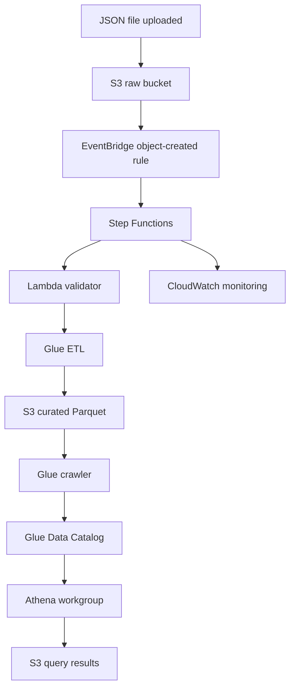

# Architecture

## Independently managed Terraform roots

- Core foundation: repository root, state key `terraform/project/terraform.tfstate`.
- Temporary data pipeline: `environments/dev-pipeline-temp`, state key `terraform/project/data-pipeline-temp.tfstate`.
- Backend bootstrap: `bootstrap/`, local state by design.

## Core foundation

The root modules provision a VPC, security groups, application S3 storage, GitHub Actions OIDC access and CloudTrail auditing. The VPC uses public and private subnets in `ap-south-1a`; NAT is disabled by default.

## Temporary pipeline

The pipeline is event-driven. Lambda validates the S3 bucket/key event. Glue reads JSON and writes Parquet. The crawler updates catalog metadata. Athena queries the curated table.

## Important boundary

The temporary pipeline is not part of the core root. It must be planned, applied, inspected and cleaned up independently. Redshift is not part of this architecture.
